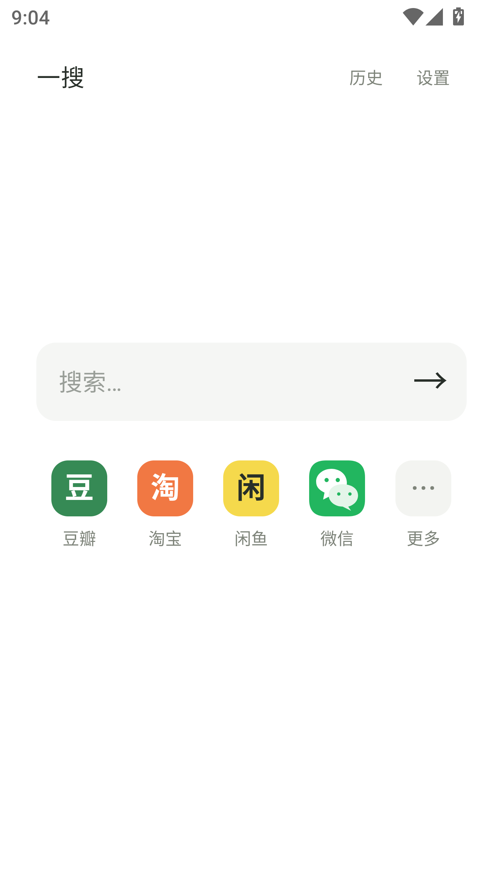

# 一搜 · 安卓主动搜索（NoFeed Android）

一搜是一款开源的 Android 主动搜索工具。在统一的输入框中输入关键词，选择豆瓣、淘宝、闲鱼或微信，即可发起对应应用内的搜索，减少打开首页后被推荐内容打断的机会。

首页采用简洁的输入框与应用图标，右侧“更多”方便选择平台。支持本地搜索历史、默认应用、桌面小组件，以及从其他应用分享文字后搜索。豆瓣、淘宝、闲鱼通过应用搜索入口跳转；微信通过首次校准后保存的坐标辅助点击和粘贴，需要主动开启系统辅助服务。应用无需账号，没有广告、订阅或统计 SDK，搜索历史保存在本机。

灵感来自 [NoFeed](https://apps.apple.com/us/app/nofeed/id6745481301)。本项目是独立编写的 Android 实现，与原作者及豆瓣、淘宝、闲鱼、微信无隶属关系。首页采用关键词输入框和应用图标，不复制原版素材或付费体系。未核实原版停服状态。

## 安装与使用

当前开发预览版：0.3.2（Android 8.0 / API 26 及以上，通用架构）。公开预览包见 [Releases](https://github.com/oldjie/yisou/releases)；本地直接构建产物为 `dist/yisou-0.3.2.apk`。复制到手机，使用系统文件管理器打开安装。系统可能要求允许该文件管理器安装应用。

1. 输入关键词。
2. 点击豆瓣、淘宝、闲鱼或微信图标；右侧“更多”中点击应用名称也能选择。
3. 点击输入框右侧箭头或键盘搜索键。

用户已在 HarmonyOS 4.2.0 上确认 0.2.0 的豆瓣 7.136.0、淘宝 10.68.0、闲鱼 7.28.70 搜索均正常。0.3.2 保留这三条入口。

微信 0.3.2 改为坐标自动化，不再读取控件或识别界面。首次在系统辅助功能中开启“一搜 · 微信搜索辅助”，保持微信登录并位于聊天列表首页，手机竖屏。针对用户提供的微信 8.0.78 截图，预设搜索图标、输入框和键盘搜索键的相对位置；首次只需按提示点选弹出的“粘贴”，保存后自动回放。版本或屏幕比例不匹配时，会引导完整的四点校准。也可在设置 → 微信搜索辅助 → 校准搜索位置重新校准，或清除位置。

搜索词会写入系统剪贴板并自动粘贴，不读取原剪贴板，不需要另外安装自动化工具，不跳转网页。普通搜索限时 20 秒，首次校准最多 2 分钟，切换应用后取消。屏幕、字号、微信版本或输入法标识变化会使保存的位置失效；键盘内部布局变化时也应主动重新校准。坐标动作不能证明搜索结果已返回。用户已报告 0.3.0 的控件识别方式在其微信 8.0.78 上只打开应用，因此该旧方式已移除。真实微信的新方案仍需手机验收。

0.3.2 加速已保存位置的搜索回放，保留首次校准的等待。短按、页面切换等待已压缩，输入框点击和长按合并调度；长按仍遵守系统配置的触发门槛，不能保证全程 0.5 秒。已有校准可继续使用，无需重新设置。

需要预先安装目标应用。豆瓣、淘宝、闲鱼无法启动时，应用会询问是否改用网页；不会自动将搜索词交给浏览器。微信只提供客户端搜索辅助。平台链接和坐标流程由代码维护，可能随应用版本变化，成功发出操作不代表已确认进入搜索结果，详见 [兼容性和测试](docs/TESTING.md)。

支持本地按日期排列的历史、点击历史重搜、长按删除、清空历史、关闭记录、默认应用、桌面小组件和系统分享文字到一搜。没有账号、订阅、广告或统计 SDK，不需要服务器；仅微信搜索使用可选的系统无障碍服务，空闲时不读取窗口。

0.3.2 已删除应用别名和自定义搜索链接功能，旧版本这两类偏好会在升级后清理。应用显示名称和图标已更换；内部包名仍保留 org.nofeed.android，用于兼容覆盖升级和已有历史记录。

<p align="center">
  
</p>

## 构建

推荐用 Android Studio 导入此目录，安装 Android SDK Platform 35、Build Tools 35.0.0，以 JDK 17 运行 Gradle，同步后构建 APK。工程使用 Android Gradle Plugin 8.7.3 / Gradle 8.9；Java 源码无第三方运行依赖。源码同时提供官方 Gradle Wrapper。

```powershell
$env:JAVA_HOME = '你的 JDK 17 路径'
$env:ANDROID_HOME = '你的 Android SDK 路径'
.\gradlew.bat :app:assembleDebug :app:lintDebug
```

也可在 Windows 使用 SDK 命令行工具直接构建，不需要 Gradle 和 Maven 下载：

```powershell
# 已安装 Platform 35、Build Tools 35.0.0 后：
.\scripts\test.ps1
.\scripts\build.ps1
```

直接构建产物位于 `dist/`。脚本首次运行在 `.tools/development.p12` 生成本机开发签名，只供开发和安装预览。它与 Gradle 的 debug 签名不同，切换构建方式时可能需要先卸载旧版（会清除本地数据）。

没有 SDK 时，可运行 `scripts/bootstrap-sdk.py`（Python 3，仅标准库），从 Google 官方下载固定版本并校验 SHA-1。SDK 解压至被 Git 忽略的 `.tools/sdk`；使用前请阅读并接受 [Android SDK 条款](https://developer.android.com/studio/terms)。

## 正式发布

公开 APK 是开发签名预览包，不是应用商店正式版。原预览签名私钥只留在开发者本机，仓库没有密钥。自行克隆后构建会生成不同的本机开发签名，不能覆盖现有预览包。正式发布者应独立保管发布密钥，完成目标版本真机验收；不同签名不能直接覆盖安装。

MIT 许可证见 [LICENSE](LICENSE)。[隐私政策](PRIVACY.md)、[贡献说明](CONTRIBUTING.md)、[安全报告](SECURITY.md) 和 CI 已准备好。原版截图仅供本地调研，`docs/reference/` 被忽略，不纳入开源源码包。

## 隐私与安全

应用无联网权限、广告或统计 SDK。默认在应用私有目录保存搜索历史，可关闭、逐条删除或清空。微信搜索会覆盖剪贴板，并按保存位置模拟点击；不会读取旧剪贴板、界面控件树或截图。坐标可能因布局变化而误触，应重新校准，具体行为见[隐私政策](PRIVACY.md)。

首次公开前的范围、发现与限制见[检查记录](docs/SECURITY_REVIEW.md)。发布使用文件白名单，避免上传本机签名、私人原图、SDK 和调试数据。可重复检查：

```powershell
python scripts/security-check.py
# 在 Git 仓库中还可检查已跟踪文件是否与白名单完全一致：
python scripts/security-check.py --staged
```

## 新增平台

入口集中在 `app/src/main/java/org/nofeed/android/SearchTarget.java`。增加平台时定义名称、Android 包名、应用搜索 URI、网页搜索 URL；在 Manifest `queries` 中加包名，并补充图标、小组件和真机验收记录。`{query}` 统一按 UTF-8 编码，防止 `&`、`#`、`+` 等字符改变 URL 参数结构。

设计和原版调研见 [docs/RESEARCH.md](docs/RESEARCH.md)。
