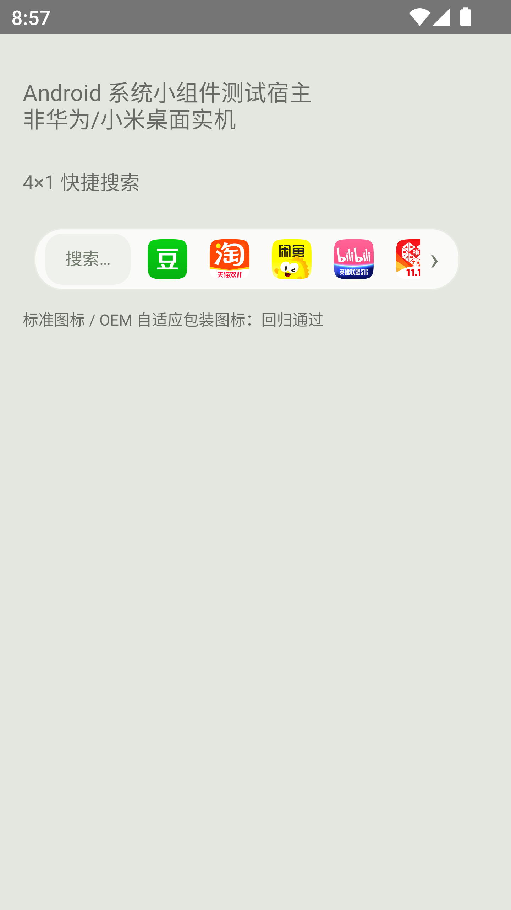
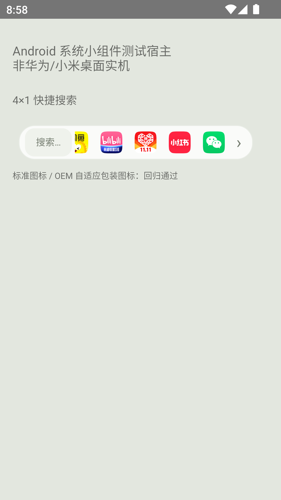
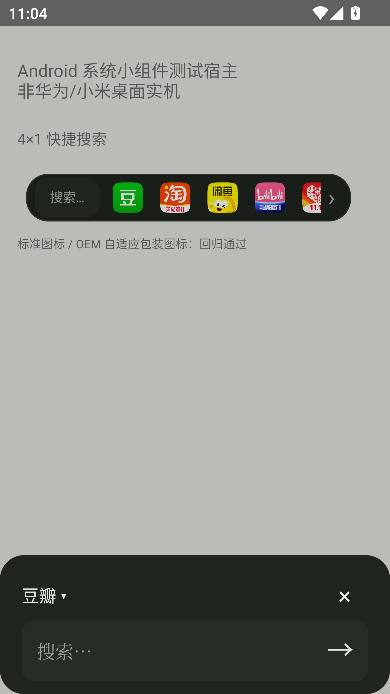
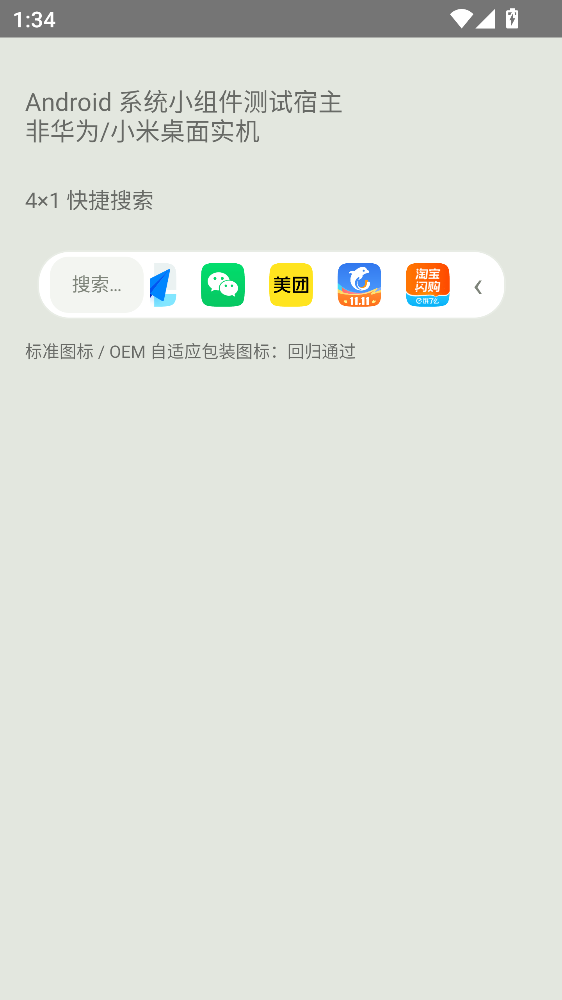

# 桌面小组件

0.8.0 继续只提供 **一搜 · 搜索（4×1）**，即四列一行。左侧是搜索入口，右侧是一横排十一个应用图标，不带名称，可左右滑动。右端小箭头可切换前后组，用于不便拖动或桌面手势冲突时。

点图标会弹出已选平台的轻量输入窗，输入关键词后直接搜索；点搜索框可先输入再选择平台。桌面搜索栏是输入窗入口，标准 RemoteViews 不支持在桌面直接放 EditText。组件不展示搜索历史或上次关键词。

## 添加方式

升级后打开一搜，在“设置 → 添加桌面小组件”请求固定到桌面；不支持固定请求的桌面会显示手动指引。也可从系统组件列表查找“一搜”。

华为通常在桌面双指捏合后，进入“服务卡片”，下滑到底部的“窗口小工具”添加；依据[华为官方说明](https://consumer.huawei.com/cn/support/content/zh-cn15978796/)。小米等系统使用其桌面的小部件列表，菜单以系统版本为准。

旧 4×2 搜索面板不再提供，升级后请改加 4×1；已有 4×1 保留同一个组件身份。组件最小高度按旧系统的一格规则设置，外观固定为 44dp 的细栏。具体占格由桌面网格决定；若桌面初次放成其他格数，请长按调整到四列一行。

## 兼容与数据

使用标准 Android AppWidget。Android 12 及以上根据组件宽度调整图标视口；Android 8–11 使用较窄的固定视口，仍可左右滚动到十一个应用。采用旋转的系统 ListView 和反向旋转的图标实现横向展示，不引入额外手势权限。模拟器的 Lawnchair 桌面实测会优先拦截横滑，系统宿主中则可滑动；遇到此类桌面请点右端箭头切换。华为和小米真机仍待验收，系统测试宿主通过不等同于厂商桌面通过。

使用内置的十一个平台图标，未安装也正常显示，不随系统主题改变。默认已安装优先；从“更多”手动排序后，组件使用相同的自定义顺序，恢复默认后重新按安装状态排序。微信需要原有辅助权限与校准位置；组件不会改变其点击节奏。搜索词仍按历史开关处理，箭头仅保存本地的显示状态。快捷输入窗不再显示源码按钮；完整许可与对应源码入口在主应用设置中。

开发参考：[RemoteViews 支持的视图和集合](https://developer.android.com/reference/android/widget/RemoteViews)、[AppWidgetHost](https://developer.android.com/develop/ui/views/appwidgets/host)。

 

以上为系统测试宿主，非厂商桌面实拍。

[无源码按钮的快捷输入窗](widget-input-yisou-0.6.0.png)。

## 外观

0.7.0 的组件与快捷输入窗遵循设置中的外观选择。手动浅色或深色不随桌面颜色改变；跟随系统使用深浅资源并在配置变化时刷新。组件在进程退出后的即时更新仍取决于桌面是否重新加载资源，厂商桌面的实际效果以真机为准。组件形态、搜索入口和品牌图标原色保持。

0.8.0 的美团、携程、高德地图与淘宝闪购使用同一行和同一输入窗，不增加组件尺寸或新交互。原手动顺序保留，新项追加；可沿用左右拖动和末端箭头到达新增项。

