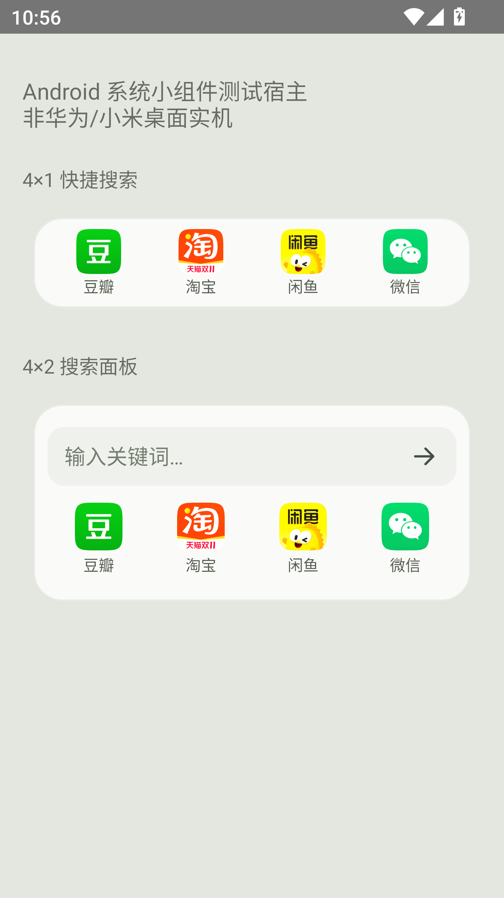

# 桌面小组件

0.4.0 提供两种入口，均为标准 Android AppWidget，适用于支持 Android 窗口小工具的桌面：

| 组件 | 默认尺寸 | 用法 |
| --- | --- | --- |
| 一搜 · 快捷搜索 | 4 列 × 1 行 | 点豆瓣、淘宝、闲鱼或微信图标，输入关键词后提交 |
| 一搜 · 搜索面板 | 4 列 × 2 行 | 可先点搜索栏输入再选应用，也可直接点应用图标 |

这里的 4×1 / 4×2 对应“一行四列 / 两行四列”。系统桌面的实际占格受网格、留白和字号影响，可长按调整尺寸；组件会在高度变化后切换紧凑或面板布局。

点击后显示一个轻量输入窗，自动请求键盘，提交后直达目标应用，不必先打开一搜完整首页。标准 RemoteViews 不支持 EditText，因此组件里的搜索栏是打开输入窗的入口；不会在桌面保留或展示上次搜索词。默认应用沿用设置偏好，输入窗中也可切换。

## 添加方式

安装或升级后先打开一次一搜，在“设置 → 添加桌面小组件”选择规格。支持系统固定组件请求的桌面会弹出确认；其他桌面显示手动指引。

华为通常可在桌面双指捏合，进入“服务卡片”，下滑到底部选择“窗口小工具”，找到“一搜”后添加。依据[华为官方说明](https://consumer.huawei.com/cn/support/content/zh-cn15978796/)。小米等 Android 桌面可在桌面的小部件添加列表查找“一搜”，菜单名称以该桌面版本为准。

桌面预览、大小分配和固定请求由桌面实现决定。已在 Android 12 的实际 AppWidgetHost 中检查组件加载、点击和尺寸切换；这不是 HarmonyOS 4.2 或小米实机验收，仍需对应设备复测。

微信仍需先在一搜中开启已有的搜索辅助并校准位置；组件沿用相同流程和保存位置。关键词只在提交后按历史设置保存，组件自身不增加账号、联网权限或统计服务。

上图是测试宿主，非手机桌面实拍；图标读取自本机已安装软件。若目标软件未安装，显示中性占位，应用名称保留。

开发参考：[Android 小组件](https://developer.android.com/develop/ui/views/appwidgets)、[AppWidgetHost](https://developer.android.com/develop/ui/views/appwidgets/host)。
